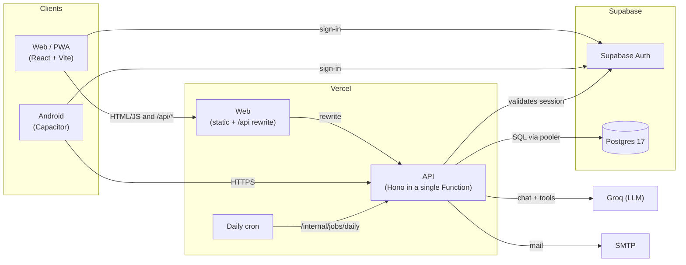
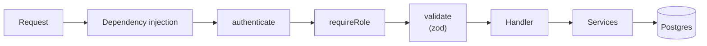
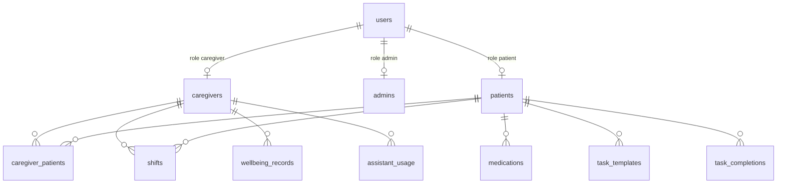
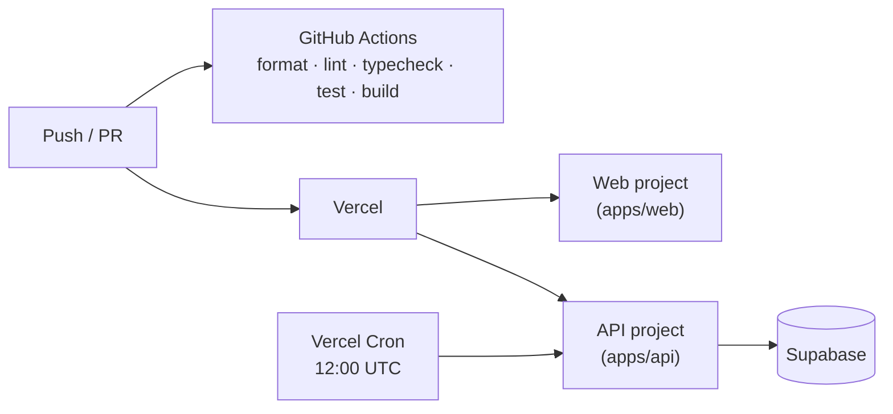

# Cuidarte+

[](https://github.com/Nicolasgh91/red-cuidarte/actions/workflows/ci.yml)


Web and Android application for people who care for older adults. It coordinates shifts, daily tasks and medication, supports the caregiver's own wellbeing, and provides a conversational assistant.

## Table of contents

- [Overview](#overview)
- [Key capabilities](#key-capabilities)
- [Architecture](#architecture)
- [Tech stack](#tech-stack)
- [Repository layout](#repository-layout)
- [Getting started](#getting-started)
- [Scripts](#scripts)
- [Testing and CI](#testing-and-ci)
- [Database and migrations](#database-and-migrations)
- [Deployment and operations](#deployment-and-operations)
- [Documentation](#documentation)
- [Contributing](#contributing)
- [Team and license](#team-and-license)

## Overview

Cuidarte+ (Red Cuidar) centralizes day-to-day care: who is on shift, which tasks and medication doses are pending, and how the caregiver is doing. Access is role-based:

| Role        | User                       | Capabilities                                                                                                            |
| ----------- | -------------------------- | ----------------------------------------------------------------------------------------------------------------------- |
| `caregiver` | Caregiver                  | Shifts (manual or via chat), daily tasks, medication for assigned patients, assistant, wellbeing, breaks and reminders. |
| `admin`     | Care coordination          | Onboarding and assignment of caregivers and patients, medication, mail log, content management.                         |
| `patient`   | Care recipient (with mail) | Read-only view of the day: who is caring for them, today's medication, and an emergency button.                         |

## Key capabilities

- **Shifts** with overlap detection enforced at the database level, including shifts that cross midnight.
- **Daily tasks** generated from templates and scheduled medication doses.
- **Wellbeing records** per caregiver.
- **Guided breaks and reminders** (water, stretching, relaxation): local on web, native notifications on Android.
- **Conversational assistant** with tool calling to query and create shifts, subject to a per-user daily quota.
- **Caregiver ↔ patient linking** through a single-use code generated by the patient.
- **Coordinator-editable content**: landing page, resources, FAQ and legal pages.

## Architecture

### System context



### Design principles

- **The API is the only data access path.** Clients never talk to Postgres or the Supabase Data API; Supabase is used purely as managed Postgres and an identity provider.
- **Stateless backend.** Each request carries what it needs (session, chat history); anything that must outlive a request is persisted in the database.
- **End-to-end types without code generation.** The web app imports the API's `AppType` through Hono RPC, so a contract change breaks the client's typecheck.
- **Injected dependencies.** Database, auth, mail, LLM and clock are passed to `createApp(deps)`, so the whole API can be tested without external services.

### Decisions and trade-offs

| Decision                           | Rationale                                                                                    | Trade-off                                                      |
| ---------------------------------- | -------------------------------------------------------------------------------------------- | -------------------------------------------------------------- |
| Raw SQL (`postgres.js`), no ORM    | Explicit queries, constraints and exclusion rules live in SQL migrations as the single truth | More boilerplate; row types are maintained by hand             |
| One Vercel Function for all routes | One deployable unit and a single routing layer                                               | Coarse scaling and observability granularity                   |
| Postgres 16 locally and in CI      | Lightweight image for fast CI and local setup                                                | Production runs 17: avoid 17-only features or align the images |

### Request lifecycle



Role checks are applied per route prefix; per-patient assignment checks live in each service.

### Data model (summary)



Per-module detail lives in [`docs/architecture.md`](docs/architecture.md).

## Tech stack

| Layer          | Technologies                                                             |
| -------------- | ------------------------------------------------------------------------ |
| Frontend       | React 19, Vite 8, React Router 8, TanStack Query 5, token-based CSS, PWA |
| Mobile         | Capacitor 8 (Android), Local Notifications                               |
| API            | Hono 4 (typed RPC), zod 4, postgres.js (raw SQL), Nodemailer             |
| Data and auth  | Supabase: Postgres 17 and Supabase Auth                                  |
| AI             | Groq (OpenAI-compatible endpoint, tool calling)                          |
| Infrastructure | Vercel (static site, Functions, Cron), GitHub Actions                    |
| Quality        | Strict TypeScript, ESLint, Prettier, Vitest, Testing Library             |

## Repository layout

```
apps/
  api/         Hono + TypeScript REST API, deployed as a Vercel Function
  web/         React + Vite SPA (PWA) and Capacitor Android project (android/)
supabase/
  migrations/  versioned SQL schema (single source of truth)
  seed/        initial data
scripts/       local migration runner and backup restore
docs/          technical documentation (Spanish)
.github/       CI and backup workflows
```

pnpm workspace with two packages and no shared package: the web app consumes the API's types and content directly from `api`.

## Getting started

### Prerequisites

- Node.js 22+
- pnpm 11
- Docker (local Postgres)

### Install

```bash
pnpm install
pnpm db:up          # local Postgres 16 on port 54329
pnpm db:migrate     # applies supabase/migrations to the "cuidarte" database
```

### Run locally

1. Copy `apps/api/.env.example` to `apps/api/.env.local` and `apps/web/.env.example` to `apps/web/.env.local`, then fill in the values. Each variable is documented in [`docs/ops.md`](docs/ops.md#variables-de-entorno).
2. Start the API and the web app in separate terminals:

```bash
pnpm --filter api dev   # http://localhost:8787
pnpm --filter web dev   # http://localhost:5173
```

## Scripts

| Command                            | Description                                |
| ---------------------------------- | ------------------------------------------ |
| `pnpm lint`                        | ESLint across all packages                 |
| `pnpm typecheck`                   | TypeScript type check                      |
| `pnpm test`                        | API and web tests                          |
| `pnpm format`                      | Format the repository with Prettier        |
| `pnpm format:check`                | Verify formatting (used by CI)             |
| `pnpm db:up`                       | Start local Postgres with Docker Compose   |
| `pnpm db:migrate`                  | Apply migrations to the local database     |
| `pnpm --filter web build`          | Production web build                       |
| `pnpm --filter web cap:sync`       | Build and sync the Android project         |
| `pnpm --filter web cap:open`       | Open the Android project in Android Studio |
| `pnpm --filter api eval:assistant` | Run the assistant evaluation script        |

## Testing and CI

| Package | Tooling                          | Approach                                                                                                                            |
| ------- | -------------------------------- | ----------------------------------------------------------------------------------------------------------------------------------- |
| API     | Vitest against **real Postgres** | Each run recreates `cuidarte_test` from the migrations. Routes are exercised with `app.request()` and fake dependencies.            |
| Web     | Vitest, jsdom, Testing Library   | Unit tests for pure logic (reminders, dates, API client) and integration tests for screens and sign-in against a mocked API client. |

```bash
pnpm db:up && pnpm test
```

On every pull request and push to `main`, GitHub Actions runs `format:check`, `lint`, `typecheck`, `test` (with a Postgres service container) and the web build.

## Database and migrations

- The schema lives exclusively in [`supabase/migrations/`](supabase/migrations/) as `<timestamp>_<name>.sql` files.
- Validate every migration locally with `pnpm db:migrate` and `pnpm test`.
- Apply migrations to the production Supabase project (`red-cuidarte`) in order and **before** deploying the API version that requires them.
- A weekly workflow produces a database backup; restore it with [`scripts/restore-backup.sh`](scripts/restore-backup.sh).

## Deployment and operations



| Component     | Platform                  | Notes                                                       |
| ------------- | ------------------------- | ----------------------------------------------------------- |
| Web           | Vercel (static site)      | `/api/*` rewrite to the API (same origin) and SPA fallback. |
| API           | Vercel Functions          | Single function for all routes; daily job via Vercel Cron.  |
| Database/Auth | Supabase (single project) | Connection through the pooler in transaction mode.          |
| Android       | Capacitor                 | Packages the same web build.                                |

Vercel and Supabase configuration is in [`docs/ops.md`](docs/ops.md); open items and the launch checklist are in [`docs/pendientes.md`](docs/pendientes.md).

## Documentation

Detailed documents are written in Spanish.

| Document                                           | Contents                                                |
| -------------------------------------------------- | ------------------------------------------------------- |
| [`docs/architecture.md`](docs/architecture.md)     | Architecture, current decisions, where to change what   |
| [`docs/spec.md`](docs/spec.md)                     | Functional specification                                |
| [`docs/vistas-por-rol.md`](docs/vistas-por-rol.md) | Screens and views per role, with diagrams               |
| [`docs/pendientes.md`](docs/pendientes.md)         | Open items and launch checklist (single source)         |
| [`docs/ops.md`](docs/ops.md)                       | Environment variables, Vercel, Supabase, limits, launch |
| [`docs/android.md`](docs/android.md)               | Android app: build and publishing                       |
| [`docs/dns.md`](docs/dns.md)                       | DNS and mail configuration (SPF, DKIM, DMARC)           |

## Contributing

- CI runs on every pull request and push to `main`; run the same checks locally first: `pnpm format:check`, `pnpm lint`, `pnpm typecheck`, `pnpm test`.
- Schema changes go in a new file under `supabase/migrations/`.
- API contract changes are picked up by the web client through `AppType`; a divergence fails its typecheck.

## Team and license

Cuidarte+ is a product of Jorge Chiesa.

| Role                    | Person            |
| ----------------------- | ----------------- |
| Product                 | Jorge Chiesa      |
| Development (volunteer) | Nicolás Hruszczak |
| Business                | Angie Gonzalez    |

Proprietary. All rights reserved.
