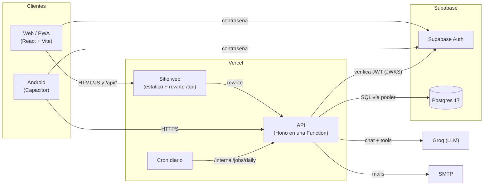
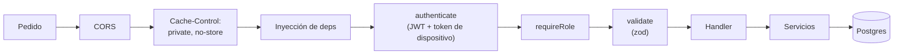
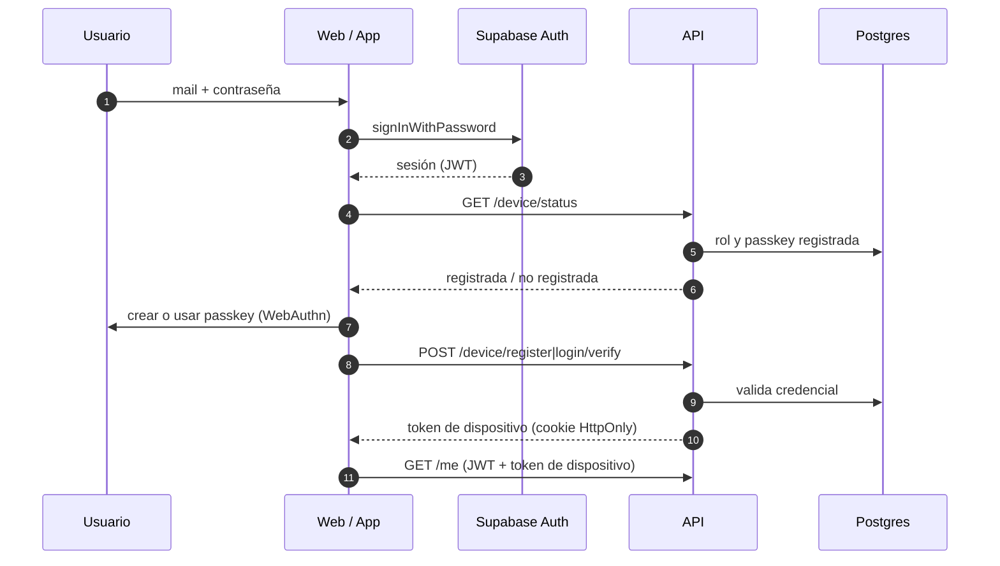
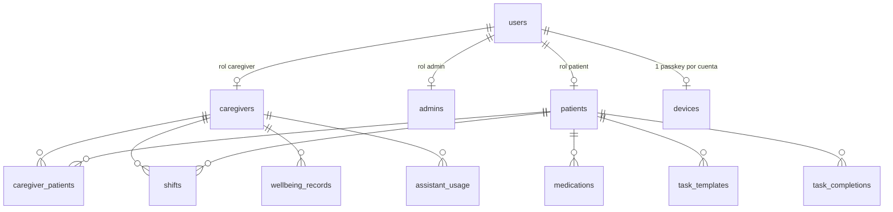
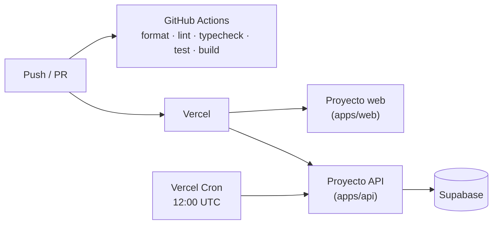

# Cuidarte+

[](https://github.com/Nicolasgh91/red-cuidarte/actions/workflows/ci.yml)


Aplicación web y Android para personas que cuidan a adultos mayores: organiza turnos, tareas y medicación, acompaña el bienestar de quien cuida y ofrece un asistente conversacional.

## Índice

- [Descripción](#descripción)
- [Funcionalidades](#funcionalidades)
- [Stack tecnológico](#stack-tecnológico)
- [Arquitectura](#arquitectura)
- [Estructura del monorepo](#estructura-del-monorepo)
- [Primeros pasos](#primeros-pasos)
- [Scripts](#scripts)
- [Tests](#tests)
- [Base de datos y migraciones](#base-de-datos-y-migraciones)
- [Despliegue](#despliegue)
- [Seguridad](#seguridad)
- [Documentación](#documentación)
- [Equipo](#equipo)

## Descripción

Cuidarte+ (Red Cuidar) centraliza el día a día del cuidado: quién está de turno, qué tareas y tomas de medicación quedan pendientes y cómo se siente la persona que cuida. La aplicación tiene tres roles:

| Rol         | Quién                      | Qué puede hacer                                                                                                        |
| ----------- | -------------------------- | ---------------------------------------------------------------------------------------------------------------------- |
| `caregiver` | Cuidador/a                 | Turnos (a mano o por chat), tareas diarias, medicación de sus pacientes, asistente, bienestar, pausas y recordatorios. |
| `admin`     | Coordinación               | Alta y asignación de cuidadores y pacientes, medicación, restablecimiento de passkeys, registro de mails y contenido.  |
| `patient`   | Persona cuidada (con mail) | Vista de solo lectura del día: quién la cuida, medicación del día y botón de emergencia.                               |

## Funcionalidades

- **Turnos** con detección de superposición (también a nivel de base de datos) y turnos que cruzan la medianoche.
- **Tareas diarias** generadas a partir de plantillas y de las tomas de medicación programadas.
- **Medicación cifrada** en la aplicación con AES-256-GCM.
- **Bienestar privado**: registros que solo ve quien los cargó.
- **Pausas guiadas y recordatorios** (agua, estirar, relajar), locales en web y con notificaciones nativas en Android.
- **Asistente conversacional** con herramientas para consultar y cargar turnos, con cuota diaria por usuario.
- **Vinculación cuidador ↔ paciente** mediante código de un solo uso generado por el paciente.
- **Contenido editable** por la coordinación: landing, recursos, preguntas frecuentes y páginas legales.
- **Ingreso con dos factores**: mail y contraseña más una passkey por cuenta.

## Stack tecnológico

| Capa            | Tecnologías                                                                             |
| --------------- | --------------------------------------------------------------------------------------- |
| Frontend        | React 19, Vite 8, React Router 8, TanStack Query 5, CSS con tokens, PWA                 |
| Mobile          | Capacitor 8 (Android), Local Notifications                                              |
| API             | Hono 4 (RPC tipado), zod 4, postgres.js (SQL sin ORM), SimpleWebAuthn, jose, Nodemailer |
| Datos y Auth    | Supabase: Postgres 17 y Supabase Auth                                                   |
| IA              | Groq (endpoint compatible con OpenAI, tool calling)                                     |
| Infraestructura | Vercel (sitio estático, Functions y Cron), GitHub Actions                               |
| Calidad         | TypeScript estricto, ESLint, Prettier, Vitest, Testing Library                          |

## Arquitectura

### Contexto



Principios de diseño:

- **Solo la API accede a la base.** Los clientes nunca hablan con Postgres ni con la Data API de Supabase; Supabase se usa como Postgres y proveedor de Auth.
- **Backend sin estado.** Cada pedido trae lo necesario (JWT, token de dispositivo, historial del chat); lo que debe persistir entre pedidos se guarda en la base.
- **Tipos de punta a punta sin generación de código.** La web importa el tipo `AppType` de la API mediante Hono RPC: un cambio de contrato rompe el typecheck del cliente.
- **Dependencias inyectadas.** Base, Auth, mail, LLM y reloj se inyectan en `createApp(deps)`, lo que permite testear la API completa sin servicios externos.

### Ciclo de un pedido en la API



La autorización por rol se aplica por prefijo de ruta; la autorización por asignación (si un cuidador atiende a un paciente determinado) se verifica en cada servicio.

### Autenticación



### Modelo de datos (resumen)



El detalle completo de cada módulo está en [`docs/architecture.md`](docs/architecture.md).

## Estructura del monorepo

```
apps/
  api/         API REST en Hono + TypeScript, desplegada como Vercel Function
  web/         SPA en React + Vite (PWA) y proyecto Android de Capacitor (android/)
supabase/
  migrations/  esquema de la base versionado en SQL (única fuente de verdad)
  seed/        datos iniciales
scripts/       migración local y restauración de backups
docs/          documentación técnica
.github/       workflows de CI y backup
```

Workspace de pnpm con dos paquetes; no hay paquetes compartidos. La web consume los tipos y el contenido directamente del paquete `api`.

## Primeros pasos

### Requisitos

- Node.js 22 o superior
- pnpm 11
- Docker (Postgres local)

### Instalación

```bash
pnpm install
pnpm db:up          # Postgres 16 local en el puerto 54329
pnpm db:migrate     # aplica supabase/migrations sobre la base "cuidarte"
```

### Ejecución en local

1. Copiar `apps/api/.env.example` a `apps/api/.env.local` y `apps/web/.env.example` a `apps/web/.env.local`, y completar los valores. La descripción de cada variable está en [`docs/ops.md`](docs/ops.md#variables-de-entorno).
2. Levantar la API y la web en terminales separadas:

```bash
pnpm --filter api dev   # http://localhost:8787
pnpm --filter web dev   # http://localhost:5173
```

## Scripts

| Comando                      | Descripción                                  |
| ---------------------------- | -------------------------------------------- |
| `pnpm lint`                  | ESLint en todos los paquetes                 |
| `pnpm typecheck`             | Chequeo de tipos de TypeScript               |
| `pnpm test`                  | Tests de API y web                           |
| `pnpm format`                | Formatea el repositorio con Prettier         |
| `pnpm format:check`          | Verifica el formato (lo usa CI)              |
| `pnpm db:up`                 | Levanta el Postgres local con Docker Compose |
| `pnpm db:migrate`            | Aplica las migraciones a la base local       |
| `pnpm --filter web build`    | Build de producción de la web                |
| `pnpm --filter web cap:sync` | Build y sincronización del proyecto Android  |
| `pnpm --filter web cap:open` | Abre el proyecto Android en Android Studio   |

## Tests

| Paquete | Herramientas                   | Enfoque                                                                                                                                                                            |
| ------- | ------------------------------ | ---------------------------------------------------------------------------------------------------------------------------------------------------------------------------------- |
| API     | Vitest sobre **Postgres real** | Cada corrida recrea `cuidarte_test` con las migraciones. Las rutas se prueban con `app.request()` y dependencias falsas; un autenticador WebAuthn por software cubre las passkeys. |
| Web     | Vitest, jsdom, Testing Library | Unitarios de lógica pura (recordatorios, fechas, cliente de la API) e integración de pantallas e ingreso con un cliente de API simulado.                                           |

```bash
pnpm db:up && pnpm test
```

En cada pull request y push a `main`, GitHub Actions ejecuta `format:check`, `lint`, `typecheck`, `test` (con un Postgres de servicio) y el build de la web.

## Base de datos y migraciones

- El esquema vive exclusivamente en [`supabase/migrations/`](supabase/migrations/), en archivos `<timestamp>_<nombre>.sql`.
- Cada migración se valida en local con `pnpm db:migrate` y `pnpm test`.
- Las migraciones se aplican a los entornos de Supabase en orden y antes del despliegue de la versión de la API que las requiere.
- Toda tabla nueva debe habilitar Row Level Security.
- Un workflow semanal genera un `pg_dump` cifrado con GPG; se restaura con [`scripts/restore-backup.sh`](scripts/restore-backup.sh).

## Despliegue



| Componente  | Plataforma                     | Notas                                                                |
| ----------- | ------------------------------ | -------------------------------------------------------------------- |
| Web         | Vercel (sitio estático)        | Rewrite de `/api/*` a la API (mismo origen) y fallback de SPA.       |
| API         | Vercel Functions               | Una sola función para todas las rutas; tarea diaria por Vercel Cron. |
| Base y Auth | Supabase (entornos dev y prod) | Conexión por pooler en modo transacción.                             |
| Android     | Capacitor                      | Empaqueta el mismo build de la web.                                  |

Variables y configuración de Vercel y Supabase en [`docs/ops.md`](docs/ops.md); lo que falta y el checklist de lanzamiento en [`docs/pendientes.md`](docs/pendientes.md).

## Seguridad

- Ningún secreto se guarda en el repositorio: se gestionan como GitHub Secrets y variables de entorno de Vercel.
- RLS habilitado en todas las tablas sin políticas, y permisos revocados para los roles `anon` y `authenticated`: la Data API de Supabase no expone datos.
- Doble factor: JWT de Supabase más un token de dispositivo emitido tras verificar la passkey (cookie `HttpOnly`, `Secure`, `SameSite=Strict` en la web).
- Medicación cifrada en la aplicación; la base nunca ve la clave ni el texto plano.
- Todas las respuestas de la API se envían con `Cache-Control: private, no-store`.

## Documentación

| Documento                                              | Contenido                                                 |
| ------------------------------------------------------ | --------------------------------------------------------- |
| [`docs/architecture.md`](docs/architecture.md)         | Arquitectura, decisiones vigentes y dónde tocar cada cosa |
| [`docs/spec.md`](docs/spec.md)                         | Especificación funcional                                  |
| [`docs/vistas-por-rol.md`](docs/vistas-por-rol.md)     | Pantallas y vistas por rol, con diagramas                 |
| [`docs/pendientes.md`](docs/pendientes.md)             | Pendientes y checklist de lanzamiento (único lugar)       |
| [`docs/ops.md`](docs/ops.md)                           | Variables, Vercel, Supabase, límites y lanzamiento        |
| [`docs/passkeys.md`](docs/passkeys.md)                 | Passkeys: requisitos, alternativas por equipo y errores   |
| [`docs/android.md`](docs/android.md)                   | App Android: build, passkeys y publicación                |
| [`docs/dns.md`](docs/dns.md)                           | DNS y configuración de mail (SPF, DKIM, DMARC)            |
| [`docs/play-data-safety.md`](docs/play-data-safety.md) | Declaración de seguridad de datos para Google Play        |

## Equipo

Cuidarte+ es un producto de Jorge Chiesa.

| Rol                     | Persona           |
| ----------------------- | --------------    |
| Producto                | Jorge Chiesa      |
| Desarrollo (ad honorem) | Nicolás Hruszczak |
| Comercial               | Angie Gonzalez    |
