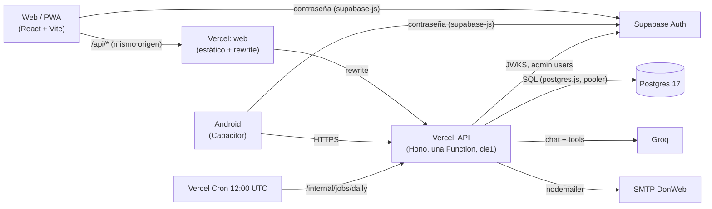

# Arquitectura de Cuidarte+

Qué piezas hay, cómo se conectan, por qué están así y dónde tocar para cada cambio. El _qué_ funcional está en [`spec.md`](spec.md); la operación (variables, Vercel, Supabase, límites, lanzamiento) en [`ops.md`](ops.md).

## 1. Visión general

| Rol         | Quién                                | Qué hace                                                                                                     |
| ----------- | ------------------------------------ | ------------------------------------------------------------------------------------------------------------ |
| `caregiver` | Cuidador/a                           | Turnos (a mano o por chat), tareas diarias, asistente, bienestar (privado), pausas, recursos, recordatorios. |
| `admin`     | Coordinación (se crea solo por SQL)  | Altas y asignaciones, medicación, restablece passkeys, ve mails, edita el contenido de la web.               |
| `patient`   | Persona cuidada (solo si tiene mail) | Vista de solo lectura «Hoy»: quién la cuida, medicación del día, botón de urgencia, código para vincularse.  |

Principios:

- **Solo la API toca la base.** El navegador nunca habla con Postgres ni con la Data API de Supabase; Supabase se usa como Postgres + Auth.
- **Backend sin estado.** Cada pedido trae lo necesario (JWT, token de la passkey, historial del chat). Lo que tiene que sobrevivir entre pedidos (desafíos WebAuthn, cuotas, límites) va a la base.
- **Costo de infraestructura US$ 0:** Vercel Hobby, Supabase Free, Groq gratis, GitHub Actions ([límites](ops.md#límites-de-los-planes-gratuitos)).
- **Tipos de punta a punta sin codegen:** la web importa el tipo `AppType` de la API (Hono RPC).



## 2. Estructura

```
apps/api/          Hono + TypeScript, una Vercel Function
  api/index.ts       entrada en Vercel (hono/vercel); src/dev.ts, entrada local (puerto 8787)
  src/app.ts         createApp(deps): middlewares, montaje de rutas, AppType
  src/routes/        un archivo por prefijo de URL
  src/services/      lógica de dominio (cuentas, turnos, tareas, medicación, asistente, mails…)
  src/auth/          JWT de Supabase, middleware, token de la passkey
  src/lib/           validación (zod), límites de pedidos, cifrado, fechas de Argentina
  src/content/       artículos, FAQ y textos por defecto (los usa también la web)
  test/              vitest contra Postgres real
apps/web/          React 19 + Vite (PWA) y Capacitor (android/)
  src/auth/          AuthProvider (sesión + passkey), pantallas sin sesión, Supabase
  src/api/           cliente Hono RPC, errores, hooks de React Query por dominio
  src/views/         pantallas por rol (caregiver/, admin/, patient/, shared/)
  src/reminders/     recordatorios (web y Android)
supabase/          migrations/ (única fuente del esquema), seed/
scripts/           migración local y restauración de backups
```

Workspace de pnpm con dos paquetes y sin paquetes compartidos: la web importa de `apps/api` solo `AppType` y `src/content`. Imports relativos con extensión `.js` (ESM de Node en Vercel). TypeScript 6 (no 7: `typescript-eslint` todavía no lo soporta).

## 3. API

**Stack:** Hono 4, zod 4, `postgres` (porsager) con SQL a mano, `jose`, `@simplewebauthn/server`, nodemailer. Sin ORM.

| Prefijo                                                       | Autenticación                      | Rol                                                        |
| ------------------------------------------------------------- | ---------------------------------- | ---------------------------------------------------------- |
| `GET /health`, `GET /content`                                 | ninguna                            | –                                                          |
| `POST /signup`                                                | ninguna, límite por IP             | –                                                          |
| `POST /logout`                                                | ninguna, solo `ALLOWED_ORIGINS`    | –                                                          |
| `/internal`                                                   | `Bearer CRON_SECRET` (timing-safe) | –                                                          |
| `/device`                                                     | JWT, sin token de la passkey       | cualquiera registrado                                      |
| `/me`, `/contact`                                             | JWT + token                        | cualquiera (`/me/patients*`, `/me/medications*`: cuidador) |
| `/shifts`, `/tasks`, `/wellbeing`, `/reminders`, `/assistant` | JWT + token                        | `caregiver`                                                |
| `/patient`                                                    | JWT + token                        | `patient`                                                  |
| `/admin`                                                      | JWT + token                        | `admin`                                                    |

- El rol se controla por prefijo en `app.ts`; la **asignación** (¿este cuidador cuida a esta persona?) la controla cada servicio (`services/access.ts` o `caregiver_id = user.id` en el SQL).
- **Dependencias inyectadas** ([`deps.ts`](../apps/api/src/deps.ts), [`createDeps.ts`](../apps/api/src/createDeps.ts)): `env`, `sql`, `verifier`, `authAdmin`, `mailer`, `llm`, `now`. En los tests ([`test/harness.ts`](../apps/api/test/harness.ts)) son falsas salvo la base. Los handlers las leen con `c.get("deps")`.
- **Base** ([`db.ts`](../apps/api/src/db.ts)): pooler de Supabase en modo transacción (`max: 1`, `prepare: false`), un cliente por pedido cerrado al terminar (una conexión guardada en una instancia congelada puede estar muerta). Las columnas `date` vuelven como `"YYYY-MM-DD"`.
- **Errores:** `HttpError(status, code, message)`; toda respuesta de error es `{ error: { code, message } }`, con `code` estable y `message` en español para mostrar. El primer error de zod sale como 400 `invalid_input`. Lo no previsto se loguea y sale como 500.
- **Límites de pedidos** ([`lib/rateLimit.ts`](../apps/api/src/lib/rateLimit.ts)): `hit()` cuenta en `rate_hits` dentro de una transacción con `pg_advisory_xact_lock`, así pedidos simultáneos no se saltean el límite. Registro: 5 por IP por hora; canje de códigos: 10 por cuidador por hora; contacto: 3 por usuario en 24 h. El asistente usa su propia cuota diaria (`assistant_usage`), que se devuelve si Groq falla.
- **Cuentas** ([`services/accounts.ts`](../apps/api/src/services/accounts.ts)): alta del admin, autorregistro y alta de pacientes por el cuidador pasan por `createAccount`: usuario de Auth ya confirmado (sin contraseña si la crea el admin) + filas en una transacción; si falla la base, se borra el usuario de Auth.
- **Medicación** ([`services/medications.ts`](../apps/api/src/services/medications.ts)): cifrada con AES-256-GCM. Admin y cuidador comparten alta y baja; el cuidador solo para sus pacientes asignados.
- **Fechas:** «hoy», semanas y cumpleaños en hora de Argentina ([`lib/time.ts`](../apps/api/src/lib/time.ts)).

## 4. Web y Android

**Stack:** React 19, Vite 8, react-router 8, TanStack Query 5, `hono/client`, `@supabase/supabase-js` (solo Auth), `@simplewebauthn/browser`, Capacitor 8. CSS plano con variables. Sin store global: el estado del servidor vive en React Query.

```
App.tsx  /privacidad (pública, la pide Google Play)
         * → ToastProvider → AuthProvider → AuthGate (pantallas sin sesión hasta "ready")
               → LayerProvider (pausa guiada, urgencia) → RoleApp (GET /me)
                 → [RemindersRuntime, solo cuidadores] → AppShell → RoleRoutes
```

- **Navegación:** [`nav.ts`](../apps/web/src/nav.ts) tiene, por rol, el menú (`NAV`), la pantalla inicial (`HOME`) y las rutas (`VIEWS`). El filtro por rol en la web es solo de experiencia: **la autorización la hace la API**.
- **Cliente de la API** ([`api/client.ts`](../apps/web/src/api/client.ts)): `hc<AppType>`. En producción `VITE_API_URL=/api` (rewrite, mismo origen). Cada pedido lleva el JWT, `credentials: "include"` (la cookie del token), timeout de 20 s y, en Android, `X-Device-Token`. Ante 401 cierra la sesión; ante 403 `device_login_required` hace **un** re-ingreso con passkey y **un** reintento. `unwrap()` convierte la respuesta en datos o `ApiError`; los hooks están en `api/queries/<dominio>.ts`.
- **Recordatorios:** la configuración se guarda en la API; los horarios los calcula `dailyReminders` ([`reminders/scheduler.ts`](../apps/web/src/reminders/scheduler.ts)), igual para las dos plataformas. En la web se revisa cada 20 s con la app abierta (toast + `Notification`); en Android son notificaciones locales diarias ([`native.ts`](../apps/web/src/reminders/native.ts)).
- **PWA:** manifiesto, sin service worker (`public/sw.js` solo da de baja al que pudo quedar instalado). **Android:** Capacitor empaqueta el mismo `dist/`; detalles en [`android.md`](android.md).

## 5. Ingreso y passkey

Dos factores: **mail y contraseña** (Supabase Auth) y **una passkey por cuenta**, siempre con verificación de usuario (huella, rostro o PIN). Al verificarla, la API emite un **token** (HS256, 30 días, `sub` = usuario, `cid` = credencial) que se exige en cada pedido junto con el JWT, del mismo usuario y con la credencial vigente.

```mermaid
sequenceDiagram
  participant W as Web
  participant SA as Supabase Auth
  participant API
  W->>SA: signInWithPassword → JWT
  W->>API: GET /device/status
  alt sin passkey
    W->>API: register/options → crear passkey → register/verify
  else con passkey y sin token vigente
    W->>API: login/options → usar passkey → login/verify
  end
  API-->>W: Set-Cookie __Host-cuidarte_device (HttpOnly; en Android, también en el cuerpo)
```

| Situación                                   | Qué pasa                                                                                                                                                                                                                                                                                                                                                              |
| ------------------------------------------- | --------------------------------------------------------------------------------------------------------------------------------------------------------------------------------------------------------------------------------------------------------------------------------------------------------------------------------------------------------------------- |
| Vuelve en un equipo ya verificado           | Entra directo por una pista en `localStorage` (no es una credencial); si el token venció, el primer pedido da 403.                                                                                                                                                                                                                                                    |
| Token vencido (403 `device_login_required`) | Un intento automático de re-ingreso, compartido por los pedidos simultáneos. Si el navegador pide un gesto, se muestra «Verificar con mi passkey» y no se reintenta solo hasta que la persona toque.                                                                                                                                                                  |
| Otro equipo de la misma persona             | Usa la misma passkey (sincronizada en Google o iCloud, o desde el teléfono con QR).                                                                                                                                                                                                                                                                                   |
| Quiere registrar una segunda passkey        | 409 `passkey_exists`. Solo el admin la **restablece**: con la contraseña robada no alcanza.                                                                                                                                                                                                                                                                           |
| El admin restableció la passkey             | El token viejo deja de valer al instante (su `cid` ya no coincide); el próximo ingreso registra una nueva.                                                                                                                                                                                                                                                            |
| Cerrar sesión                               | Espera `POST /logout` (borra la cookie, tope de 5 s) y `signOut` de Supabase antes de limpiar el estado local.                                                                                                                                                                                                                                                        |
| Falla crear o verificar la passkey          | 400 con el motivo: `webauthn_origin` (la página no está en `WEBAUTHN_ORIGINS`), `webauthn_challenge` (otro intento pisó el desafío), `webauthn_user_verification` (sin huella, rostro o PIN), `challenge_expired` o `webauthn_failed`. El log `[webauthn]` trae el origen recibido y el esperado. Requisitos y alternativas por equipo: [`passkeys.md`](passkeys.md). |
| La cuenta no existe                         | Supabase responde credenciales inválidas (registro abierto apagado). Las cuentas las crea la API: alta del admin o `/registro`. Sin contraseña, se define con un código por mail en `/recuperar`.                                                                                                                                                                     |

**En el código:** API: [`auth/middleware.ts`](../apps/api/src/auth/middleware.ts), [`auth/deviceToken.ts`](../apps/api/src/auth/deviceToken.ts), [`routes/device.ts`](../apps/api/src/routes/device.ts) (los desafíos van a `webauthn_challenges`). Web: [`auth/AuthProvider.tsx`](../apps/web/src/auth/AuthProvider.tsx) (estado `loading → signed-out → passkey → ready | not-registered` y la sesión), [`auth/passkeys.ts`](../apps/web/src/auth/passkeys.ts) (ceremonias), [`auth/public.tsx`](../apps/web/src/auth/public.tsx) (landing, ingreso, registro y recuperación).

## 6. Datos y seguridad

El esquema vive en [`supabase/migrations/`](../supabase/migrations/); el modelo completo está en [`spec.md`](spec.md).

- **`users` no tiene FK a `auth.users`:** una persona cuidada sin mail es solo una ficha con UUID propio.
- **Turnos sin superposición:** además del chequeo en el servicio, la restricción `shifts_no_overlap` (`EXCLUDE USING gist`) lo garantiza ante pedidos simultáneos. Un turno con fin menor que inicio cruza la medianoche.
- **`task_completions`:** PK `(date, patient_id, task_key)`; `task_key` es el id de la plantilla o `med-<id>-<HH:MM>`.
- **`mail_log`:** se registra `pending` antes de enviar y `sent`/`failed` después (si el SMTP confirma pero falla la escritura, no se reenvía). Índice único parcial: un mail de cumpleaños por año.
- **RLS activado en todas las tablas, sin políticas**, y `REVOKE ALL` para `anon` y `authenticated` (también por defecto para tablas futuras): la Data API no expone nada. `test/db.test.ts` lo verifica. **Una tabla nueva tiene que hacer `enable row level security`.**
- **Bienestar privado:** solo lo lee quien lo cargó; ni el admin ni el asistente.
- Todas las respuestas salen con `Cache-Control: private, no-store`.

## 7. Asistente, tarea diaria y contenido

- **Asistente** ([`services/assistant.ts`](../apps/api/src/services/assistant.ts)): Groq (API compatible con OpenAI, modelo `GROQ_MODEL`). Recibe los últimos 14 mensajes del cliente (no se guardan conversaciones), arma el _system prompt_ con fecha de Argentina, personas asignadas, su medicación, FAQ y recursos, y hace hasta 4 rondas de herramientas (`listar_turnos`, `agregar_turnos`, que usa el mismo `createShifts` que la pantalla). 20 mensajes por día y cuidador. `POST /assistant/undo` borra solo turnos propios con `source = 'assistant'`. Errores: 429 `assistant_limit` o `assistant_busy` (Groq falló o llegó a su límite, el principal riesgo de capacidad).
- **Tarea diaria** ([`services/dailyJob.ts`](../apps/api/src/services/dailyJob.ts)): Vercel Cron a las 12:00 UTC (09:00 AR, con precisión de una hora). Hace un `select 1` para que Supabase no pause el proyecto, borra los `rate_hits` vencidos y manda los mails de cumpleaños (los del 29/2 se saludan el 28/2 en años no bisiestos).
- **Contenido editable:** el admin edita frases, recursos, FAQ, textos de la landing y las páginas Acerca, Términos y Privacidad (`AdminContenido`). Los originales viven en [`apps/api/src/content/`](../apps/api/src/content/); lo editado se guarda completo por clave en `site_content` (sin fila, o si deja de ser válido, vale el original). Se valida con [`content/schemas.ts`](../apps/api/src/content/schemas.ts). Se muestra como texto: no hay HTML. `GET /content` es público.

## 8. Tests

| App | Herramientas                     | Enfoque                                                                                                                                                                                                     |
| --- | -------------------------------- | ----------------------------------------------------------------------------------------------------------------------------------------------------------------------------------------------------------- |
| API | Vitest sobre **Postgres real**   | `test/globalSetup.ts` recrea `cuidarte_test` con las migraciones; `test/harness.ts` arma la app con dependencias falsas y llama `app.request()`. Un autenticador WebAuthn por software prueba las passkeys. |
| Web | Vitest + jsdom + Testing Library | Lógica pura (recordatorios, fechas, cliente) e integración con `test/render.tsx` (`renderWithApp` + `fakeApi`). El ingreso se prueba con Supabase y `@simplewebauthn/browser` simulados con `vi.mock`.      |

`docker compose up -d db && pnpm test`. CI hace lo mismo con un Postgres de servicio.

## 9. Decisiones vigentes

- **Passkey como segundo factor, sin atarla a un equipo.** No se puede identificar el equipo físico, y una passkey sincronizada sirve en varios. Una por cuenta, registrada en el primer ingreso; otra solo si el admin la restablece. **Verificación de usuario obligatoria**, para que sea un factor real. El token viaja en la web solo en la cookie `__Host-cuidarte_device` (HttpOnly, Secure, `SameSite=Strict`): un script no la puede leer. La CSP de `apps/web/vercel.json` y no renderizar HTML editable (regla de lint contra `dangerouslySetInnerHTML`) son las otras defensas.
- **Sin tokens anti-CSRF:** ninguna ruta acepta solo la cookie, todas exigen además `Authorization: Bearer`. `POST /logout` no pide sesión y por eso solo acepta orígenes de `ALLOWED_ORIGINS`.
- **App nativa:** a los orígenes de `NATIVE_ORIGINS` se les devuelve el token en el cuerpo y se les acepta `X-Device-Token`. `Origin` no prueba identidad, pero igual hacen falta el JWT y la passkey del mismo usuario.
- **Se quitaron (2026-11-01):** la reautenticación con passkey para acciones del admin y la auditoría de eventos (`device_events`). `devices` conserva la última IP, el último uso y la fecha de registro.
- **Medicación cifrada en la aplicación (AES-256-GCM), no con `pgcrypto`:** con `pgcrypto` la clave viajaría en cada consulta y quedaría en logs. `times` queda en claro (hace falta para el checklist). Sin rotación de clave: perderla es perder la medicación.
- **Ingreso con mail y contraseña, autorregistro con rol:** `POST /signup` crea la cuenta ya confirmada (el registro abierto de Supabase está apagado: no hay usuarios de Auth sin rol). Las cuentas del admin definen su contraseña con un código de 6 dígitos (`verifyOtp` de recuperación), que funciona igual en PWA y Capacitor, sin _deep links_. No se verifica el mail del autorregistro: una cuenta nueva no ve nada hasta que la asignan.
- **Vincular paciente con código:** un paciente que se registra solo comparte un código de un solo uso (48 h); nadie se asigna a una persona por su mail sin que ella lo sepa.
- **Contacto:** se manda a la casilla de `SMTP_FROM` con `Reply-To` de quien escribe; no se guarda el mensaje en la base (si el SMTP falla, la pantalla conserva lo escrito). El asunto se limpia de saltos de línea y caracteres de control (evita inyectar cabeceras) y no se copia a `mail_log`.
- **Migraciones a mano:** el SQL se ejecuta en el editor de Supabase, nunca desde CI. Primero se agrega, se despliega la API y recién después se borra lo viejo.

## 10. Dónde tocar para…

| Quiero…                                  | Pasos                                                                                                                                                                                                        |
| ---------------------------------------- | ------------------------------------------------------------------------------------------------------------------------------------------------------------------------------------------------------------ |
| **Agregar un endpoint**                  | Esquema zod en `lib/schemas.ts` → handler en `routes/<dominio>.ts` con `validate(...)` → lógica en `services/` → test en `test/<dominio>.test.ts`. Prefijo nuevo: montarlo en `app.ts` con su `requireRole`. |
| **Consumirlo desde la web**              | Hook en `src/api/queries/<dominio>.ts` con `useApi()` + `unwrap()`; los tipos salen de `AppType`.                                                                                                            |
| **Agregar una pantalla**                 | Componente en `src/views/<rol>/` y entrada en `VIEWS` (y en `NAV` si va en el menú) de `src/nav.ts`.                                                                                                         |
| **Cambiar el esquema**                   | Migración nueva en `supabase/migrations/`; `pnpm db:migrate` y `pnpm test` en local; el SQL se corre a mano en Supabase antes del deploy (lo que borra, después).                                            |
| **Limitar un pedido**                    | `hit(sql, "<uso>:<clave>", { limit, windowMs, now, message })` de `lib/rateLimit.ts`.                                                                                                                        |
| **Agregar una dependencia externa**      | Interfaz en `deps.ts`, real en `createDeps.ts`, falsa en `test/harness.ts`.                                                                                                                                  |
| **Agregar una variable de entorno**      | `src/env.ts` (API) o `.env.example` (web), [`ops.md`](ops.md#variables-de-entorno) y el panel de Vercel.                                                                                                     |
| **Agregar una herramienta al asistente** | Definición y ejecución en `services/assistant.ts`; cuidar el costo en tokens del _system prompt_.                                                                                                            |

## 11. Pendientes conocidos

- **Pruebas con servicios reales sin hacer:** passkeys en Android, API en Vercel (SMTP, JWKS real, cron, arranque en frío) y calidad de Groq con herramientas ([`ops.md`](ops.md#pruebas-pendientes-con-servicios-reales)).
- **Dominios:** se habla de `api.redasistir.online`, pero hoy la web reescribe a `red-cuidarte.vercel.app`; los dominios propios no están configurados.
- **Versiones de Postgres:** Docker local y CI usan 16; Supabase y el backup, 17.
- **Build de Vercel sin `strict`:** el build de la API no lee el `tsconfig` base, por eso `pnpm typecheck` compila también con `--strict false` y los tipos de entrada salen de los esquemas de zod.
- Sin rotación de `MEDICATIONS_KEY`; términos y privacidad provisorios hasta la revisión legal.
