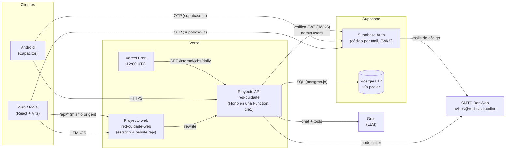
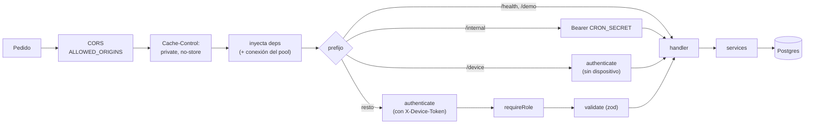
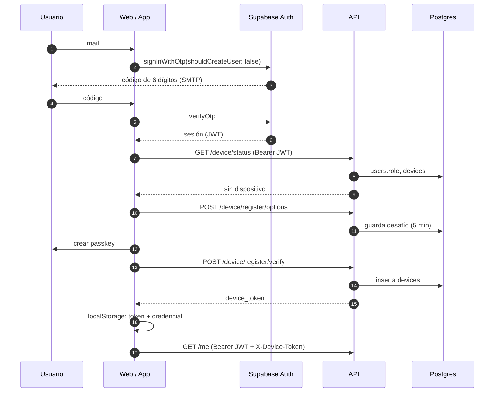
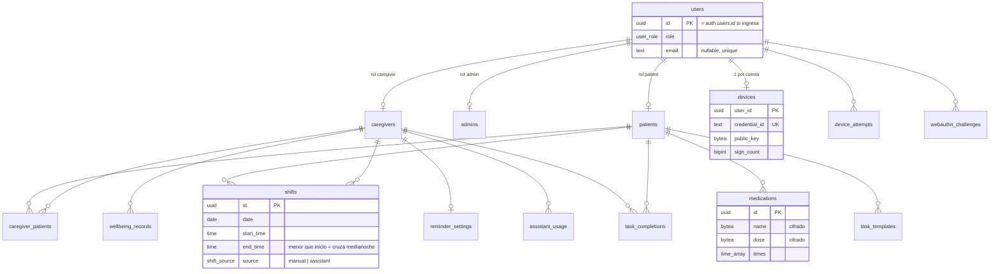
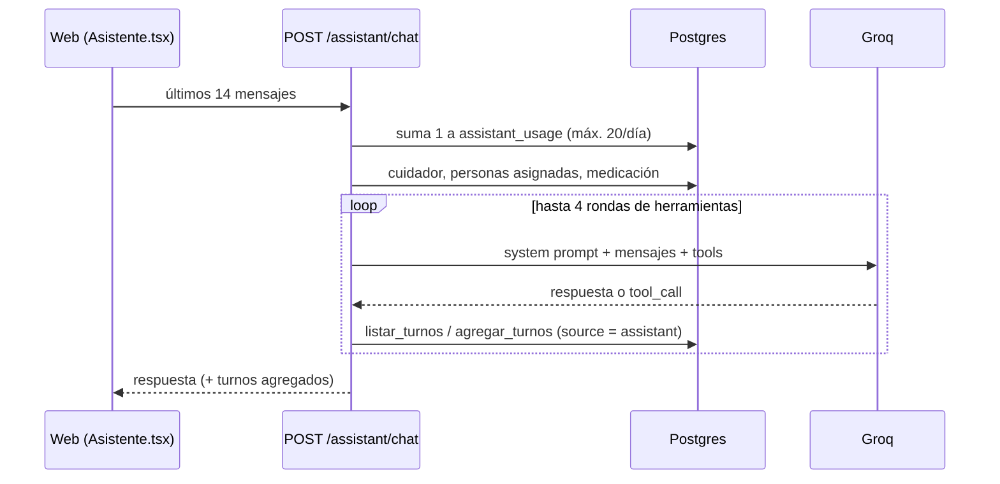

# Arquitectura de Cuidarte+

Guía para quien se suma al proyecto: qué piezas hay, cómo se conectan y dónde tocar para cada tipo de cambio. El _qué_ funcional está en [`tasks/spec-v2.md`](../tasks/spec-v2.md); el _por qué_ de cada decisión, en [`tasks/roadmap.md`](../tasks/roadmap.md) (D1–D6) y [`docs/decisions.md`](decisions.md). Este documento no las repite: las enlaza.

## Índice

1. [Visión general](#1-visión-general)
2. [Estructura del monorepo](#2-estructura-del-monorepo)
3. [API (`apps/api`)](#3-api-appsapi)
4. [Web y Android (`apps/web`)](#4-web-y-android-appsweb)
5. [Autenticación y dispositivo](#5-autenticación-y-dispositivo)
6. [Modelo de datos y seguridad](#6-modelo-de-datos-y-seguridad)
7. [Asistente](#7-asistente)
8. [Tareas programadas y mails](#8-tareas-programadas-y-mails)
9. [Despliegue e infraestructura](#9-despliegue-e-infraestructura)
10. [Tests](#10-tests)
11. [Modo demo](#11-modo-demo)
12. [Dónde tocar para…](#12-dónde-tocar-para)
13. [Pendientes e inconsistencias conocidas](#13-pendientes-e-inconsistencias-conocidas)

---

## 1. Visión general

Cuidarte+ es una app para personas que cuidan a adultos mayores. Hay tres roles:

| Rol         | Quién                                | Qué hace                                                                                                     |
| ----------- | ------------------------------------ | ------------------------------------------------------------------------------------------------------------ |
| `caregiver` | Cuidador/a                           | Turnos (a mano o por chat), tareas diarias, asistente, bienestar (privado), pausas, recursos, recordatorios. |
| `admin`     | Coordinación (se crea solo por SQL)  | Da de alta cuidadores y personas cuidadas, asigna, carga medicación, libera/autoriza dispositivos, ve mails. |
| `patient`   | Persona cuidada (solo si tiene mail) | Vista de solo lectura "Hoy": quién la cuida, medicación del día, botón de emergencia.                        |

Principios que atraviesan todo el diseño:

- **Solo la API toca la base.** El navegador nunca habla con Postgres ni con la Data API de Supabase; Supabase se usa como Postgres + Auth.
- **Backend sin estado.** Cada pedido trae todo lo necesario (JWT, token de dispositivo, historial del chat). Lo que tiene que sobrevivir entre pedidos (desafíos WebAuthn, cuota del asistente) va a la base.
- **Costo de infraestructura US$0.** Vercel Hobby, Supabase Free, Groq gratis, GitHub Actions. Los límites están en [`docs/free-tier.md`](free-tier.md).
- **Tipos de punta a punta sin codegen.** La web importa el tipo `AppType` de la API (Hono RPC).

### Diagrama de contexto



---

## 2. Estructura del monorepo

Workspace de pnpm con dos paquetes (`apps/*`); no hay paquetes compartidos. Lo que se comparte, la web lo importa directamente del código de la API (ver [§4.3](#43-capa-de-api)).

```
apps/api/          Hono + TypeScript, desplegado como una Vercel Function
  api/index.ts       entrada en Vercel (hono/vercel)
  src/app.ts         createApp(deps): middlewares, montaje de rutas, AppType
  src/routes/        un archivo por prefijo de URL
  src/services/      lógica de dominio (turnos, tareas, asistente, mails…)
  src/auth/          verificación de JWT, middleware, token de dispositivo
  src/lib/           validación (zod), cifrado, fechas de Argentina
  src/content/       artículos y FAQ (los usa la web y el asistente)
  test/              vitest contra Postgres real
apps/web/          React 19 + Vite (PWA) y Capacitor (android/)
  src/auth/          máquina de estados del ingreso, passkeys, controller
  src/api/           cliente Hono RPC, manejo de errores, hooks de React Query
  src/views/         pantallas por rol (caregiver/, admin/, patient/, shared/)
  src/reminders/     recordatorios locales (web y nativo)
  src/styles/        CSS plano con tokens
supabase/          migrations/ (única fuente del esquema), seed/, config.toml
scripts/           migración local y restauración de backups
.github/workflows/ ci.yml, migrate.yml, backup.yml
docs/              esta documentación
tasks/             spec, roadmap, progreso, prototipo HTML
```

Configuración común: [`tsconfig.base.json`](../tsconfig.base.json) (ES2023, `strict`, `noUncheckedIndexedAccess`, `verbatimModuleSyntax`), ESLint plano en [`eslint.config.js`](../eslint.config.js), Prettier. Los imports relativos llevan extensión `.js` (ESM de Node en Vercel).

---

## 3. API (`apps/api`)

**Stack:** Hono 4, zod 4 (`@hono/zod-validator`), `postgres` (porsager) con SQL a mano, `jose`, `@simplewebauthn/server`, nodemailer. Sin ORM.

### 3.1 Puntos de entrada

| Archivo                                    | Cuándo                                                                                                                                      |
| ------------------------------------------ | ------------------------------------------------------------------------------------------------------------------------------------------- |
| [`api/index.ts`](../apps/api/api/index.ts) | Producción. `handle()` de `hono/vercel`. La app y las dependencias se crean recién en el primer pedido, así el build no necesita variables. |
| [`src/dev.ts`](../apps/api/src/dev.ts)     | Local. `@hono/node-server` en `PORT` (8787). `pnpm --filter api dev` (lee `.env.local`).                                                    |
| [`src/app.ts`](../apps/api/src/app.ts)     | `createApp(deps)`: la usan las dos entradas y los tests. Exporta `AppType`.                                                                 |

[`vercel.json`](../apps/api/vercel.json) reescribe toda ruta a la única función, fija la región `cle1` (cerca de Supabase `us-east-2`) y declara el cron.

### 3.2 Pipeline de un pedido



Montaje de rutas (sin prefijo `/api`: ese prefijo lo agrega y saca el rewrite de la web):

| Prefijo                                                       | Autenticación                      | Rol                   | Archivo              |
| ------------------------------------------------------------- | ---------------------------------- | --------------------- | -------------------- |
| `GET /health`                                                 | ninguna                            | –                     | `app.ts`             |
| `/internal`                                                   | `Bearer CRON_SECRET` (timing-safe) | –                     | `routes/internal.ts` |
| `/demo`                                                       | ninguna, solo con `DEMO_MODE`      | –                     | `routes/demo.ts`     |
| `/device`                                                     | JWT, sin token de dispositivo      | cualquiera registrado | `routes/device.ts`   |
| `/me`                                                         | JWT + dispositivo                  | cualquiera            | `routes/me.ts`       |
| `/shifts`, `/tasks`, `/wellbeing`, `/reminders`, `/assistant` | JWT + dispositivo                  | `caregiver`           | `routes/<nombre>.ts` |
| `/patient`                                                    | JWT + dispositivo                  | `patient`             | `routes/patient.ts`  |
| `/admin`                                                      | JWT + dispositivo                  | `admin`               | `routes/admin.ts`    |

El control por rol es por prefijo (en `app.ts`); el control por **asignación** (¿este cuidador cuida a esta persona?) lo hace cada servicio con `assertAssigned` de [`services/access.ts`](../apps/api/src/services/access.ts) o filtrando por `caregiver_id = user.id` en el SQL.

### 3.3 Inyección de dependencias

[`src/deps.ts`](../apps/api/src/deps.ts) define la interfaz `Deps`; [`src/createDeps.ts`](../apps/api/src/createDeps.ts) arma las reales a partir de `process.env`:

| Dependencia       | Real                                                      | En tests (`test/harness.ts`)              | En demo              |
| ----------------- | --------------------------------------------------------- | ----------------------------------------- | -------------------- |
| `env`             | `loadEnv()` (zod, [`src/env.ts`](../apps/api/src/env.ts)) | objeto literal                            | –                    |
| `sql` / `sqlPool` | `createRecyclingSql(DATABASE_URL)`                        | conexión a `cuidarte_test`                | –                    |
| `verifier`        | JWKS remoto de Supabase                                   | JWKS local con clave ES256 generada       | acepta `demo:<uuid>` |
| `authAdmin`       | Admin API de Supabase (service role)                      | registra altas/bajas en memoria           | UUID al azar         |
| `mailer`          | SMTP (nodemailer)                                         | guarda en `sent[]`, puede fallar a pedido | solo loguea          |
| `llm`             | Groq                                                      | respuestas guionadas con `setLlm()`       | –                    |
| `now`             | `new Date()`                                              | reloj fijo (`setNow()`)                   | –                    |

Los handlers leen todo con `c.get("deps")`; nunca importan clientes globales. Para agregar un servicio externo, sumalo a `Deps`, a `createDeps` y al harness.

### 3.4 Base de datos

[`src/db.ts`](../apps/api/src/db.ts):

- Siempre a través del **pooler de Supabase en modo transacción**: `max: 1`, `prepare: false`.
- Las columnas `date` vuelven como texto `"YYYY-MM-DD"` (sin `Date` ni zonas horarias).
- `createRecyclingSql`: si la conexión estuvo 30 s ociosa, abre una nueva y cierra la vieja sin esperar. Evita los pedidos colgados cuando Vercel descongela una instancia cuya conexión el pooler ya cortó.
- Consultas con _tagged templates_ (`` sql`...` ``); transacciones con `sql.begin(...)`. Ejemplos: alta de cuidador/persona cuidada (si falla el insert, se borra el usuario recién creado en Auth), registro de dispositivo, `createShifts` (bloquea la fila del cuidador con `for update` y traduce el error `23P01` de la restricción de exclusión a 409 `shift_overlap`).

### 3.5 Errores y validación

- [`src/errors.ts`](../apps/api/src/errors.ts): `HttpError(status, code, message)` y atajos (`badRequest`, `forbidden`, `conflict`…). Toda respuesta de error tiene la forma `{ "error": { "code": "...", "message": "..." } }`: `code` es estable (lo usa la web para decidir), `message` está en español y se muestra tal cual.
- [`src/lib/validate.ts`](../apps/api/src/lib/validate.ts) envuelve `zValidator`; el primer error de zod se devuelve como 400 `invalid_input`. Los esquemas están en [`src/lib/schemas.ts`](../apps/api/src/lib/schemas.ts).
- Errores no previstos: se loguean y salen como 500 `internal`.

### 3.6 Servicios

| Servicio                           | Responsabilidad                                                                                                                        |
| ---------------------------------- | -------------------------------------------------------------------------------------------------------------------------------------- |
| `services/shifts.ts`               | Listar (incluye el día anterior por turnos que cruzan la medianoche), crear todo-o-nada con chequeo de superposición, repetir semanal. |
| `services/tasks.ts`                | Checklist diario = plantillas + tomas de medicación (`med-<id>-<HH:MM>`) + completadas del día.                                        |
| `services/medications.ts`          | Alta y lectura con cifrado AES-256-GCM ([`lib/crypto.ts`](../apps/api/src/lib/crypto.ts)).                                             |
| `services/assistant.ts` + `llm.ts` | Asistente con herramientas, ver [§7](#7-asistente).                                                                                    |
| `services/mail.ts` + `mailer.ts`   | Envío con registro en `mail_log`, plantilla de cumpleaños.                                                                             |
| `services/dailyJob.ts`             | Tarea diaria, ver [§8](#8-tareas-programadas-y-mails).                                                                                 |
| `services/access.ts`               | `assertAssigned` (cuidador ↔ persona cuidada).                                                                                         |

Fechas: "hoy", semanas y cumpleaños se calculan en hora de Argentina ([`lib/time.ts`](../apps/api/src/lib/time.ts)).

---

## 4. Web y Android (`apps/web`)

**Stack:** React 19, Vite 8, react-router 8, TanStack Query 5, cliente `hono/client`, `@supabase/supabase-js` (solo Auth), `@simplewebauthn/browser`, Capacitor 8. CSS plano con variables (sin Tailwind ni CSS-in-JS). Sin store global: el estado del servidor vive en React Query y el resto en unos pocos contextos y `localStorage`.

### 4.1 Composición

```
main.tsx          aplica tema · QueryClient · registra sw.js (solo web, solo prod)
└─ App.tsx        BrowserRouter
   ├─ /privacidad → Privacidad              (pública, la exige Google Play)
   └─ *  → ToastProvider
            └─ AuthProvider                 (máquina de estados del ingreso)
               └─ AuthGate                  (pantallas de login hasta "ready")
                  └─ LayerProvider          (modales: pausa guiada, urgencia)
                     └─ RoleApp             (GET /me)
                        └─ [RemindersRuntime, solo caregiver]
                           └─ AppShell      (header, nav por rol, DemoBar)
                              └─ RoleRoutes (rutas del rol)
```

### 4.2 Navegación por rol

[`src/nav.ts`](../apps/web/src/nav.ts) es la tabla central: `NAV` (menú), `HOME` (pantalla inicial) y `VIEWS` (ruta → componente) por rol. [`RoleRoutes.tsx`](../apps/web/src/RoleRoutes.tsx) genera las rutas a partir de `VIEWS[role]` y manda cualquier otra ruta al inicio del rol.

| Rol         | Inicio      | Pantallas (`src/views/…`)                                                                                           |
| ----------- | ----------- | ------------------------------------------------------------------------------------------------------------------- |
| `caregiver` | `/inicio`   | `Inicio`, `Turnos`, `Tareas`, `Asistente`, `Bienestar`, `Pausa`, `Recursos` + `Articulo`, `Perfil`, `Recordatorios` |
| `admin`     | `/admin`    | `Admin`, `AdminCaregivers`, `AdminPacientes`, `AdminDispositivos`, `AdminCorreos`                                   |
| `patient`   | `/paciente` | `Hoy`                                                                                                               |
| todos       | –           | `Acerca`, `Terminos` (y `/privacidad` sin sesión)                                                                   |

> El filtrado por rol en la web es solo de experiencia de uso. **La autorización real la hace la API.**

### 4.3 Capa de API

- [`src/api/client.ts`](../apps/web/src/api/client.ts): `hc<AppType>(API_URL)`. `AppType` viene del paquete `api` del workspace (`exports: ./src/app.ts`), así que cambiar una ruta en la API rompe el typecheck de la web si no coincide.
- `API_URL` sale de `VITE_API_URL`. En producción es `/api`, que el rewrite de [`apps/web/vercel.json`](../apps/web/vercel.json) manda a la API: mismo origen, sin CORS ni preflight.
- Cada pedido lleva `Authorization: Bearer <JWT de Supabase>` (o `demo:<id>`), `X-Device-Token` y un timeout de 20 s.
- Interceptor de errores de autenticación (excepto en `/device/*`):
  - 401 → la sesión venció, se cierra.
  - 403 `device_login_required` → re-ingreso con passkey transparente y se reintenta el pedido una vez.
  - 403 `device_unregistered` / `device_blocked` / `not_registered` → evento para la máquina de estados.
  - Cualquier otro 403 vuelve al llamador.
- [`src/api/errors.ts`](../apps/web/src/api/errors.ts): `unwrap()` convierte la respuesta en datos o en `ApiError(status, code, message)`; los errores de red son `status 0`.
- [`src/api/queries/*`](../apps/web/src/api/queries/): un archivo por dominio con los hooks de React Query (`useShifts`, `useToggleTask` optimista, `useAdminMutation` que invalida todo `["admin"]`, etc.). Los reintentos solo aplican a errores de red o 5xx.
- La web también importa [`apps/api/src/content`](../apps/api/src/content/index.ts) (artículos y FAQ) por ruta relativa: una sola fuente para la pantalla de recursos y el contexto del asistente.

### 4.4 PWA y Android

- **PWA:** [`public/manifest.webmanifest`](../apps/web/public/manifest.webmanifest) y un service worker propio ([`public/sw.js`](../apps/web/public/sw.js)) que cachea el _shell_ (red primero para navegación, caché primero para `/assets` e `/icons`) y nunca intercepta pedidos a otros orígenes ni no-GET.
- **Android:** Capacitor empaqueta el mismo `dist/` ([`capacitor.config.ts`](../apps/web/capacitor.config.ts), `appId` `online.redasistir.cuidarte`, que no se puede cambiar después de publicar). El único plugin es `local-notifications`. Detalles y estado en [`docs/android.md`](android.md) y [`docs/assetlinks.md`](assetlinks.md).

### 4.5 Recordatorios

Las preferencias (agua, estirar, relajar) se guardan en la API (`/reminders`); la programación es **local** en el dispositivo. Ambas implementaciones cumplen `ReminderScheduler { schedule, cancel }`:

| Plataforma | Implementación                                                     | Comportamiento                                                                                                 |
| ---------- | ------------------------------------------------------------------ | -------------------------------------------------------------------------------------------------------------- |
| Web        | [`reminders/scheduler.ts`](../apps/web/src/reminders/scheduler.ts) | `setInterval` de 20 s; solo funciona con la app abierta. Toast + `Notification` si hay permiso.                |
| Android    | [`reminders/native.ts`](../apps/web/src/reminders/native.ts)       | Notificaciones diarias programadas (canal `recordatorios`), sin alarmas exactas; funcionan con la app cerrada. |

`RemindersRuntime` elige una u otra con `Capacitor.isNativePlatform()` y solo se monta para cuidadores.

---

## 5. Autenticación y dispositivo

Dos factores: **código de 6 dígitos por mail** (Supabase Auth, sin contraseñas) y **passkey** que ata la cuenta a un único dispositivo. La API emite entonces un **token de dispositivo** (HS256, 30 días, `sub` = usuario, `cid` = credencial) que se valida en cada pedido contra la credencial vigente en `devices`. Las razones están en [`docs/decisions.md`](decisions.md) (F4 y F5).

### 5.1 Primer ingreso



### 5.2 Casos que hay que conocer

| Situación                              | Qué pasa                                                                                                                            |
| -------------------------------------- | ----------------------------------------------------------------------------------------------------------------------------------- |
| Vuelve con sesión y token guardado     | Entra directo (`ready`).                                                                                                            |
| Token de dispositivo vencido o ausente | La API responde 403 `device_login_required`; la web hace `login/options` + `login/verify` con la passkey y reintenta el pedido.     |
| La cuenta ya tiene otro dispositivo    | 403 `device_blocked` y fila `blocked` en `device_attempts`. Un admin puede **liberar** el viejo o **autorizar** el nuevo (una vez). |
| El admin liberó el dispositivo         | El token viejo deja de valer al instante (su `cid` ya no coincide); el próximo ingreso registra uno nuevo.                          |
| El mail no está dado de alta           | Supabase no crea usuarios (registro abierto apagado) → pantalla "no registrado". Los usuarios los crea la API desde el panel admin. |

### 5.3 Piezas en el código

- **API:** [`auth/verifier.ts`](../apps/api/src/auth/verifier.ts) (JWT contra JWKS, `aud: authenticated`), [`auth/middleware.ts`](../apps/api/src/auth/middleware.ts) (`authenticate`, `requireRole`), [`auth/deviceToken.ts`](../apps/api/src/auth/deviceToken.ts), [`routes/device.ts`](../apps/api/src/routes/device.ts) (WebAuthn; los desafíos van a `webauthn_challenges` porque las funciones no guardan estado).
- **Web:** [`auth/machine.ts`](../apps/web/src/auth/machine.ts) es un reducer puro con los estados `loading → signed-out → otp → device-check → ready | blocked | not-registered`. [`auth/AuthProvider.tsx`](../apps/web/src/auth/AuthProvider.tsx) conecta la máquina con los efectos; [`auth/controller.ts`](../apps/web/src/auth/controller.ts) evita chequeos simultáneos y comparte un único re-ingreso entre pedidos concurrentes; [`auth/deviceFlow.ts`](../apps/web/src/auth/deviceFlow.ts) decide registrar o ingresar; [`auth/deviceStore.ts`](../apps/web/src/auth/deviceStore.ts) guarda en `localStorage` el token y la credencial (ligada al id de usuario).

---

## 6. Modelo de datos y seguridad

El esquema vive en [`supabase/migrations/`](../supabase/migrations/) y es la única fuente de verdad (no hay migraciones dentro de las apps).



`mail_log` no tiene relaciones (registra mails por dirección). Detalles que importan:

- **`users` no tiene FK a `auth.users`:** una persona cuidada sin mail es solo una ficha con UUID propio.
- **Superposición de turnos:** además del chequeo en el servicio, la restricción `shifts_no_overlap` (`EXCLUDE USING gist` con `btree_gist` en el esquema `extensions`) la garantiza ante pedidos simultáneos.
- **`task_completions`:** PK `(date, patient_id, task_key)`; `task_key` es el id de la plantilla o `med-<id>-<HH:MM>`.
- **`mail_log`:** índice único parcial `(to_email, kind, year) WHERE kind = 'birthday'` → un mail de cumpleaños por año; los de prueba se pueden repetir.

### Seguridad de datos

- **RLS activado en todas las tablas, sin políticas**, y `REVOKE ALL` para `anon` y `authenticated` (también por defecto para tablas futuras). La Data API de Supabase no expone nada; solo la API, conectada como `postgres` por el pooler, lee y escribe. `test/db.test.ts` lo verifica.
- **Medicación cifrada en la aplicación** (AES-256-GCM, `MEDICATIONS_KEY`): la base nunca ve la clave ni el texto. Perder la clave es perder los datos.
- **Bienestar privado:** solo lo lee la persona que lo cargó; ni el admin ni el asistente acceden.
- Todas las respuestas salen con `Cache-Control: private, no-store`.
- Secretos: nunca en el repo. Lista de variables (solo nombres) en [`docs/env.md`](env.md).

---

## 7. Asistente



- Proveedor: Groq vía su endpoint compatible con OpenAI ([`services/llm.ts`](../apps/api/src/services/llm.ts)); modelo por defecto `openai/gpt-oss-120b` (`GROQ_MODEL`).
- El _system prompt_ ([`services/assistant.ts`](../apps/api/src/services/assistant.ts)) incluye fecha y hora de Argentina, las personas asignadas, su medicación, la FAQ y los artículos, más reglas de seguridad (sin diagnósticos; ante emergencias, SAME 107).
- `agregar_turnos` usa el mismo `createShifts` que la pantalla de turnos, con las mismas validaciones.
- La API no guarda conversaciones: el historial viaja desde el cliente en cada pedido.
- `POST /assistant/undo` borra solo turnos propios con `source = 'assistant'`.
- Si Groq falla, se devuelve el mensaje a la cuota. Errores: 429 `assistant_limit` (cuota diaria) o `assistant_busy` (límite de Groq). El límite de tokens por minuto de Groq es el principal riesgo de capacidad ([`docs/free-tier.md`](free-tier.md)).

---

## 8. Tareas programadas y mails

- **Vercel Cron** llama a `GET /internal/jobs/daily` todos los días a las 12:00 UTC (09:00 en Argentina; en Hobby la precisión es de una hora) con `Authorization: Bearer $CRON_SECRET`.
- [`services/dailyJob.ts`](../apps/api/src/services/dailyJob.ts):
  1. `select 1` para que Supabase Free no pause el proyecto por inactividad.
  2. Mails de cumpleaños a cuidadores (los del 29/2 se saludan el 28/2 en años no bisiestos).
- [`services/mail.ts`](../apps/api/src/services/mail.ts) registra cada envío en `mail_log` (`pending → sent | failed`); un cumpleaños fallido se reintenta en la próxima corrida, uno enviado no se repite.
- No hay `pg_cron`, triggers ni funciones en la base.
- Los mails de código de ingreso los manda Supabase Auth por el mismo SMTP de DonWeb (configurado en el panel de Supabase). DNS y SPF/DKIM/DMARC en [`docs/dns.md`](dns.md).

---

## 9. Despliegue e infraestructura

| Pieza       | Dónde                                                     | Notas                                                                                   |
| ----------- | --------------------------------------------------------- | --------------------------------------------------------------------------------------- |
| Web         | Vercel, proyecto `red-cuidarte-web` (raíz `apps/web`)     | Estático + rewrite `/api/*` → API + fallback SPA. Sirve `/.well-known/*` para passkeys. |
| API         | Vercel, proyecto `red-cuidarte` (raíz `apps/api`), `cle1` | Una sola Function para todas las rutas. Cron diario.                                    |
| Base + Auth | Supabase: `cuidarte-dev` y `cuidarte-prod`                | Postgres 17. El MCP de Supabase se usa en modo solo lectura.                            |
| LLM         | Groq                                                      | Plan gratuito.                                                                          |
| Mail        | SMTP de DonWeb                                            | `avisos@redasistir.online`.                                                             |
| Android     | Capacitor (`apps/web/android`)                            | Todavía sin compilar ni publicar.                                                       |

Pasos y variables por proyecto: [`docs/vercel-setup.md`](vercel-setup.md), [`docs/env.md`](env.md). Checklist de lanzamiento: [`docs/launch-checklist.md`](launch-checklist.md).

### GitHub Actions

| Workflow                                          | Disparador                                              | Qué hace                                                                                                            |
| ------------------------------------------------- | ------------------------------------------------------- | ------------------------------------------------------------------------------------------------------------------- |
| [`ci.yml`](../.github/workflows/ci.yml)           | PR y push a `main`                                      | Postgres de servicio → `format:check`, `lint`, `typecheck`, `test`, build de la web.                                |
| [`migrate.yml`](../.github/workflows/migrate.yml) | push a `main` que toca `supabase/migrations/**`, manual | Entorno `production`: `supabase link` → `db push --dry-run` → `db push`. Única vía para cambiar el esquema de prod. |
| [`backup.yml`](../.github/workflows/backup.yml)   | domingos 06:00 UTC, manual                              | `pg_dump` cifrado con GPG (AES256), subido como artefacto por 21 días. Se restaura con `scripts/restore-backup.sh`. |

### Flujo de un cambio de esquema

1. Nueva migración en `supabase/migrations/<timestamp>_<nombre>.sql`.
2. Local: `pnpm db:migrate` (aplica con [`scripts/migrate-local.mjs`](../scripts/migrate-local.mjs)) y `pnpm test` (los tests aplican todas las migraciones sobre `cuidarte_test`).
3. Probar en `cuidarte-dev`.
4. Merge a `main` → `migrate.yml` la aplica en producción.

---

## 10. Tests

| App | Herramientas                     | Enfoque                                                                                                                                                                                                                                                                                                                                                                                                                                                                                                  |
| --- | -------------------------------- | -------------------------------------------------------------------------------------------------------------------------------------------------------------------------------------------------------------------------------------------------------------------------------------------------------------------------------------------------------------------------------------------------------------------------------------------------------------------------------------------------------- |
| API | Vitest, **Postgres real**        | [`test/globalSetup.ts`](../apps/api/test/globalSetup.ts) recrea el esquema de `cuidarte_test` con las migraciones. [`test/harness.ts`](../apps/api/test/harness.ts) arma `createApp` con dependencias falsas y llama `app.request()` sin servidor HTTP; trae fábricas (`caregiver`, `patient`, `shift`, `bindDevice`…). Un autenticador WebAuthn por software ([`test/authenticator.ts`](../apps/api/test/authenticator.ts)) prueba el flujo de passkeys. Los archivos corren en serie (comparten base). |
| Web | Vitest + jsdom + Testing Library | Unitarios de lógica pura (máquina de auth, schedulers, fechas). Integración con [`src/test/render.tsx`](../apps/web/src/test/render.tsx): `renderWithApp` + `fakeApi` que imita el cliente Hono. `AuthProvider` acepta servicios inyectables para probar el ingreso completo.                                                                                                                                                                                                                            |

Correr todo: `docker compose up -d db && pnpm test`. CI hace lo mismo con un Postgres de servicio.

---

## 11. Modo demo

Para presentaciones: `DEMO_MODE=true` en la API y `VITE_DEMO_MODE=true` en la web.

- `GET /demo/users` lista los usuarios; la web muestra un selector y manda `Bearer demo:<id>`. No hay código por mail ni passkey.
- La API reemplaza `authAdmin` y `mailer` por versiones falsas, **pero escribe en la base real**.
- Datos de ejemplo: [`supabase/seed/demo_users.sql`](../supabase/seed/demo_users.sql) (sin medicación, porque requiere `MEDICATIONS_KEY`).

Nunca activar en producción con datos reales.

---

## 12. Dónde tocar para…

| Quiero…                                  | Pasos                                                                                                                                                                                                                                 |
| ---------------------------------------- | ------------------------------------------------------------------------------------------------------------------------------------------------------------------------------------------------------------------------------------- |
| **Agregar un endpoint**                  | Esquema zod en `lib/schemas.ts` → handler en `routes/<dominio>.ts` con `validate(...)` → lógica en `services/` → test en `test/<dominio>.test.ts`. Si es un prefijo nuevo, montarlo en `app.ts` con el `requireRole` que corresponda. |
| **Consumirlo desde la web**              | Hook en `src/api/queries/<dominio>.ts` con `useApi()` + `unwrap()`; los tipos salen solos de `AppType` (`Res<...>` en `api/types.ts`).                                                                                                |
| **Agregar una pantalla**                 | Componente en `src/views/<rol>/`, entrada en `VIEWS` (y en `NAV` si va en el menú) de `src/nav.ts`.                                                                                                                                   |
| **Cambiar el esquema**                   | Ver [flujo de un cambio de esquema](#flujo-de-un-cambio-de-esquema). Si la tabla es nueva, el `DO` de RLS no la cubre: la migración tiene que hacer `enable row level security` (los permisos por defecto ya están revocados).        |
| **Agregar una dependencia externa**      | Interfaz en `deps.ts`, implementación real en `createDeps.ts`, falsa en `test/harness.ts`.                                                                                                                                            |
| **Agregar una variable de entorno**      | `src/env.ts` (API) o `.env.example` (web), `docs/env.md` y el panel de Vercel.                                                                                                                                                        |
| **Cambiar artículos o la FAQ**           | `apps/api/src/content/index.ts` (impacta en Recursos y en el asistente).                                                                                                                                                              |
| **Agregar una herramienta al asistente** | Definición y ejecución en `services/assistant.ts`; ojo con el costo en tokens del _system prompt_ ([`docs/free-tier.md`](free-tier.md)).                                                                                              |

---

## 13. Pendientes e inconsistencias conocidas

Estado al 2026-10-22. Ver también [`tasks/progress.md`](../tasks/progress.md) y [`docs/spikes.md`](spikes.md).

- **Spikes abiertos:** S1 (passkeys en Capacitor Android: el origen `https://localhost` del WebView no coincide con el `rpId`), S2 (API en Vercel: pooler, SMTP, cron, arranque en frío) y S3 (tool calling en Groq).
- **Dominios:** el README y la spec hablan de `api.redasistir.online`, pero hoy la web reescribe a `red-cuidarte.vercel.app`; los dominios propios no están configurados.
- **Proyecto de Supabase del MCP:** `.mcp.json` apunta al mismo `project_ref` que el `SUPABASE_URL` de la API desplegada en `docs/vercel-setup.md`, mientras que la decisión D5 dice que el MCP se conecta solo a `cuidarte-dev`. Hay que confirmar si la API desplegada apunta a dev o si el MCP está en prod.
- **Versiones de Postgres:** Docker local y CI usan 16; Supabase y el cliente de backup, 17.
- **Región:** `docs/free-tier.md` la da como pendiente; `apps/api/vercel.json` ya fija `cle1`.
- **Comentarios desactualizados:** `reminders/scheduler.ts` menciona Android como fase futura (ya está en `native.ts`); `tasks/roadmap.md` y `tasks/spec-v2.md` enlazan rutas bajo `claude/` que hoy están en `tasks/`; `tasks/progress.md` dice que no hay nada commiteado.
- **Sin rotación de `MEDICATIONS_KEY`** y la política de privacidad sigue como borrador pendiente de revisión legal (F10).
