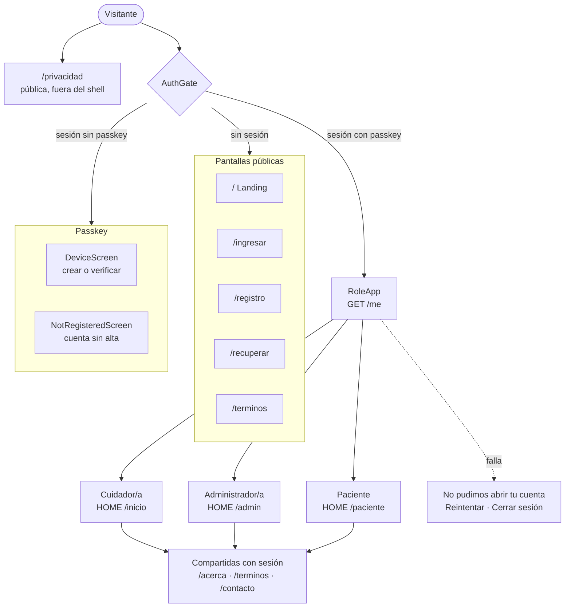
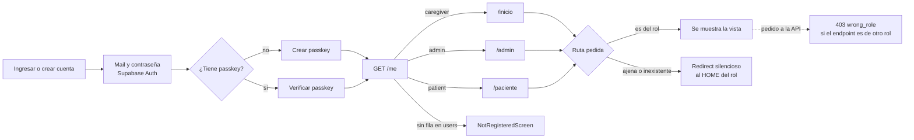
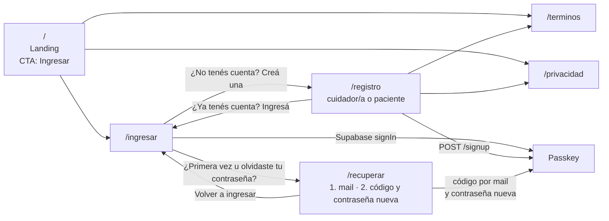
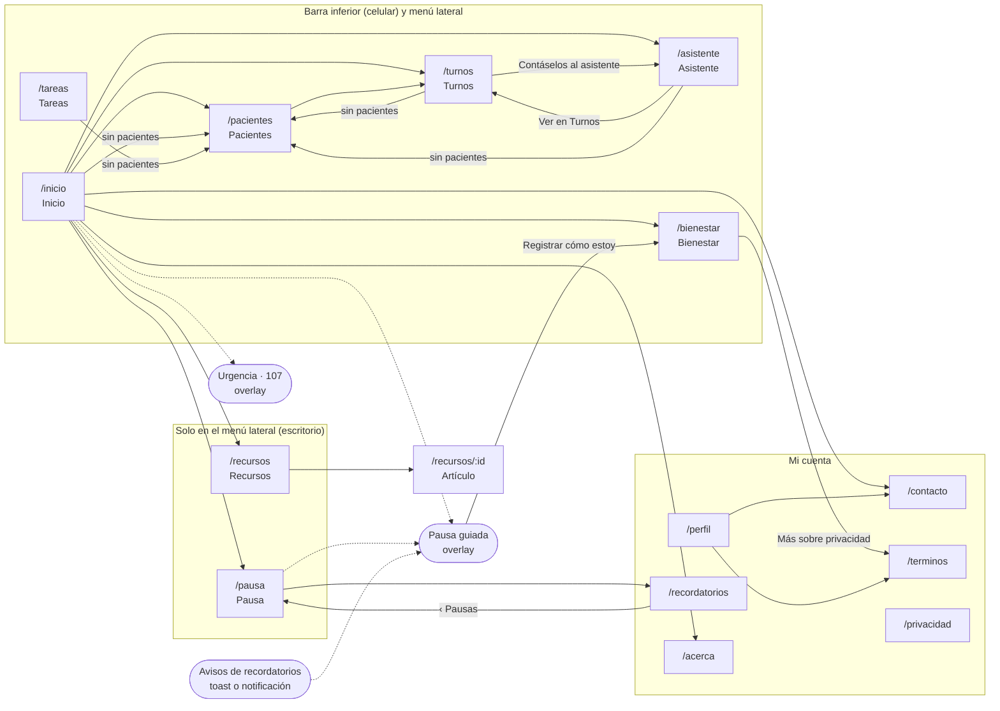
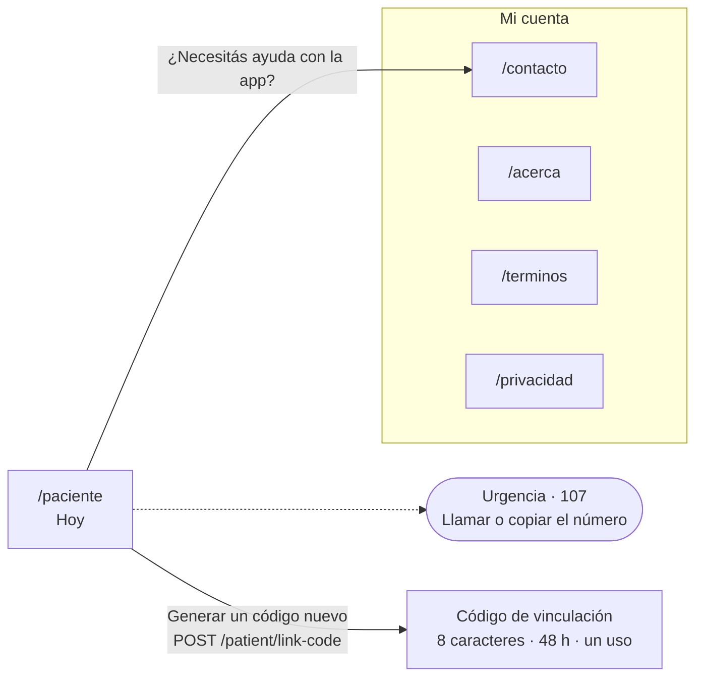
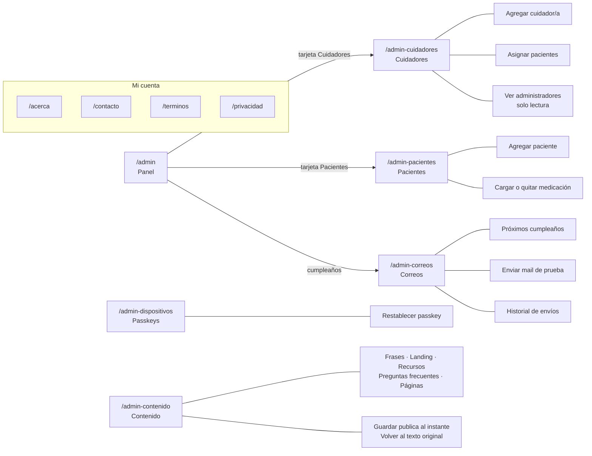
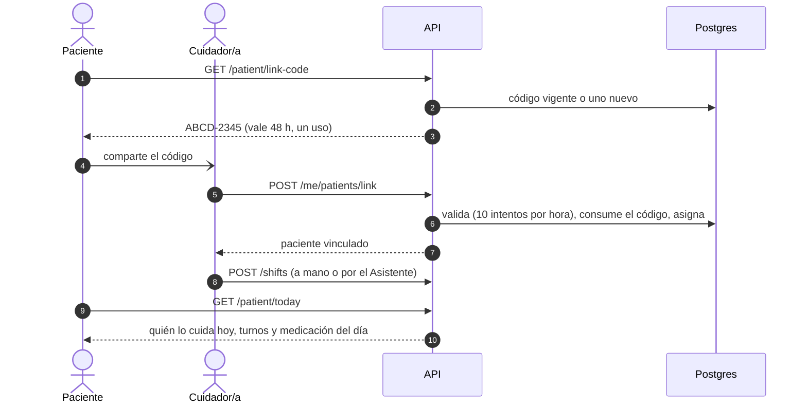

# Pantallas y vistas por rol

Mapa de las pantallas de Cuidarte+: qué existe, quién llega a cada una y qué puede hacer en ella. Qué hace cada rol, en [`spec.md`](spec.md#roles); cómo está construida la web, en [`architecture.md`](architecture.md#4-web-y-android); lo que falta, en [`pendientes.md`](pendientes.md).

**Fuente de verdad:** [`apps/web/src/nav.ts`](../apps/web/src/nav.ts) (`NAV`: menú, `HOME`: pantalla inicial, `VIEWS`: rutas de cada rol) y [`RoleRoutes.tsx`](../apps/web/src/RoleRoutes.tsx). Si agregás, quitás o renombrás una pantalla, actualizá los diagramas de este documento.

El filtro por rol de la web es solo de experiencia: **la autorización la hace la API** (`requireRole` por prefijo de ruta y la asignación cuidador-paciente en cada servicio).

## 1. Mapa general

Dentro de la app, todos los roles comparten el mismo marco (`AppShell`): logo que lleva al HOME del rol, botón **Mi cuenta** (perfil y recordatorios solo para el cuidador, Acerca, Contacto, Términos, Privacidad, tema, cerrar sesión), menú lateral en escritorio y barra inferior en el celular (hasta 860 px). El botón flotante de WhatsApp aparece para cuidadores y pacientes, no para administradores.

## 2. Acceso y ruteo por rol

## 3. Vistas por rol

### Visitante (sin sesión)

Cualquier ruta que no esté en este diagrama redirige a `/ingresar`. `/privacidad` es la única que también se ve con sesión y fuera del shell.

### Cuidador/a

Los cuidadores nuevos entran sin pacientes: **Pacientes** es el primer paso (vincular a quien ya tiene cuenta con su código, o dar de alta a alguien nuevo).

En el Asistente, una respuesta de urgencia se muestra destacada, con el botón «Llamar al 107» (`urgent: true` en la respuesta de `POST /assistant/chat`).

### Paciente

Solo lectura: ve quién lo cuida (a partir de los turnos cargados), su medicación del día y puede compartir su código. No tiene perfil ni recordatorios.

### Administrador/a

No ve turnos, tareas ni el registro de bienestar. Los administradores se cargan directo en la base: no hay pantalla para crearlos.

## 4. Vinculación paciente y cuidador

Es el único flujo que cruza dos roles. El paciente solo aparece asociado a un cuidador cuando hay **turnos** cargados; el administrador puede reemplazar el código y asignar desde **Cuidadores › Asignar**.

## 5. Qué ve cada rol

| Pantalla                                                                                                                                       | Visitante | Cuidador/a | Administrador/a | Paciente |
| ---------------------------------------------------------------------------------------------------------------------------------------------- | :-------: | :--------: | :-------------: | :------: |
| `/` Landing, `/ingresar`, `/registro`, `/recuperar`                                                                                            |     ✓     |     —      |        —        |    —     |
| `/privacidad`                                                                                                                                  |     ✓     |     ✓      |        ✓        |    ✓     |
| `/terminos`                                                                                                                                    |     ✓     |     ✓      |        ✓        |    ✓     |
| `/acerca`, `/contacto`                                                                                                                         |     —     |     ✓      |        ✓        |    ✓     |
| `/inicio`, `/pacientes`, `/turnos`, `/tareas`, `/asistente`, `/bienestar`, `/pausa`, `/recursos`, `/recursos/:id`, `/perfil`, `/recordatorios` |     —     |     ✓      |        —        |    —     |
| `/admin`, `/admin-cuidadores`, `/admin-pacientes`, `/admin-dispositivos`, `/admin-correos`, `/admin-contenido`                                 |     —     |     —      |        ✓        |    —     |
| `/paciente`                                                                                                                                    |     —     |     —      |        —        |    ✓     |

## 6. Qué puede hacer cada rol en cada pantalla

### Visitante

| Pantalla  | Acciones                                                                                                          | Endpoint       |
| --------- | ----------------------------------------------------------------------------------------------------------------- | -------------- |
| Landing   | Ir a Ingresar; leer Términos y Privacidad                                                                         | `GET /content` |
| Ingresar  | Entrar con mail y contraseña; ir a Registro o Recuperar                                                           | Supabase Auth  |
| Registro  | Crear cuenta de cuidador/a o de paciente (5 por hora por IP)                                                      | `POST /signup` |
| Recuperar | Pedir el código por mail y definir la contraseña (también es el primer ingreso de las cuentas que carga el admin) | Supabase Auth  |
| Passkey   | Crear o verificar la passkey                                                                                      | `/device/*`    |

### Cuidador/a

| Pantalla            | Acciones                                                                                     | Endpoint                                                                                                         |
| ------------------- | -------------------------------------------------------------------------------------------- | ---------------------------------------------------------------------------------------------------------------- |
| Inicio              | Ver próximo turno, tareas de hoy y frase del día; abrir Bienestar, Pausa, Urgencia           | `GET /shifts`, `GET /tasks`, `GET /me/patients`                                                                  |
| Pacientes           | Dar de alta, vincular por código, cargar y quitar medicación                                 | `POST /me/patients`, `POST /me/patients/link`, `POST /me/patients/:id/medications`, `DELETE /me/medications/:id` |
| Turnos              | Cargar (una vez o cada semana por 4 u 8 semanas), borrar y deshacer, pasar a Google Calendar | `GET/POST /shifts`, `DELETE /shifts/:id`                                                                         |
| Tareas              | Tildar, agregar y quitar tareas diarias                                                      | `GET /tasks`, `POST /tasks/completions`, `POST/DELETE /tasks/templates`                                          |
| Asistente           | Preguntar, cargar y consultar turnos, deshacer (20 mensajes por día)                         | `POST /assistant/chat`, `POST /assistant/undo`                                                                   |
| Bienestar           | Registrar ánimo, energía y estrés; ver el historial diario y semanal                         | `POST/GET /wellbeing`, `GET /wellbeing/weekly`                                                                   |
| Pausa               | Empezar una pausa guiada; ir a Recordatorios; agendar en Google Calendar                     | —                                                                                                                |
| Recordatorios       | Configurar agua, estiramientos y relajación; probar un aviso                                 | `GET/PUT /reminders`                                                                                             |
| Recursos y Artículo | Leer                                                                                         | `GET /content`                                                                                                   |
| Perfil              | Editar datos, ver la passkey, borrar la cuenta                                               | `PUT /me/profile`, `GET /device/status`, `DELETE /me`                                                            |
| Contacto            | Escribir a la casilla (3 mensajes por 24 h)                                                  | `POST /contact`                                                                                                  |

### Administrador/a

| Pantalla   | Acciones                                                                                     | Endpoint                                                                                            |
| ---------- | -------------------------------------------------------------------------------------------- | --------------------------------------------------------------------------------------------------- |
| Panel      | Ver contadores y próximo cumpleaños                                                          | `GET /admin/summary`                                                                                |
| Cuidadores | Agregar, asignar pacientes (reemplazo total), ver administradores                            | `GET/POST /admin/caregivers`, `PUT /admin/caregivers/:id/patients`, `GET /admin/admins`             |
| Pacientes  | Agregar, cargar y quitar medicación                                                          | `GET/POST /admin/patients`, `POST /admin/patients/:id/medications`, `DELETE /admin/medications/:id` |
| Passkeys   | Ver el estado y restablecer                                                                  | `GET /admin/devices`, `POST /admin/devices/:id/release`                                             |
| Correos    | Ver cumpleaños, enviar un mail de prueba, ver el historial (últimos 100)                     | `POST /admin/mail/test`, `GET /admin/mail/log`                                                      |
| Contenido  | Editar frases, landing, recursos, preguntas frecuentes y páginas legales; volver al original | `GET /admin/content`, `PUT/DELETE /admin/content/:key`                                              |

### Paciente

| Pantalla | Acciones                                                                      | Endpoint                                            |
| -------- | ----------------------------------------------------------------------------- | --------------------------------------------------- |
| Hoy      | Ver quién lo cuida y su medicación del día; generar un código nuevo; Urgencia | `GET /patient/today`, `GET/POST /patient/link-code` |
| Contacto | Escribir a la casilla                                                         | `POST /contact`                                     |
